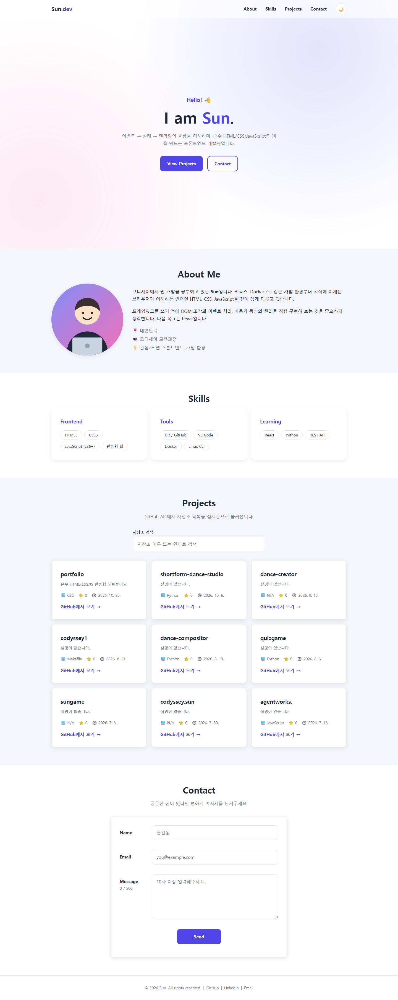
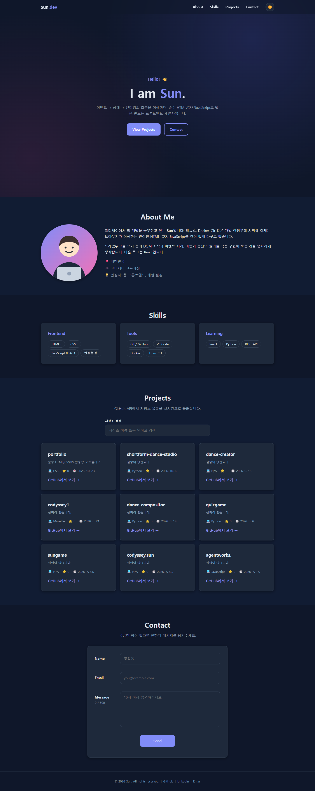
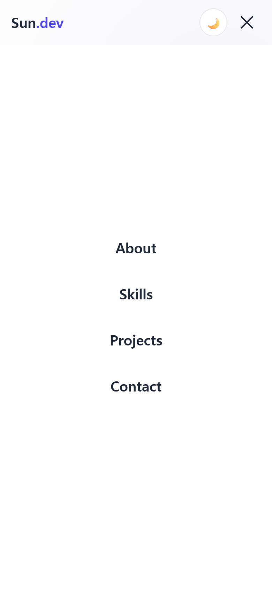

# Sun Portfolio

순수 HTML / CSS / JavaScript(외부 라이브러리 없음)로 만든 반응형 포트폴리오 웹사이트입니다.

- 배포 URL: https://ytyt0339-sun.github.io/portfolio/
- 저장소 URL: https://github.com/ytyt0339-sun/portfolio

## 스크린샷

| 데스크톱 (1440px) | 다크 모드 |
|---|---|
|  |  |

| 모바일 (390px) | 모바일 햄버거 메뉴 |
|---|---|
|  |  |

## 폴더 구조

```
portfolio/
├── index.html      # 메인 페이지 (시맨틱 마크업)
├── css/style.css   # 스타일시트 (CSS 변수, 다크 모드, 반응형)
├── js/main.js      # DOM 조작, 이벤트, GitHub API
└── images/         # 프로필 이미지, 파비콘
```

## 주요 기능

| 기능 | 구현 방법 |
|---|---|
| 반응형 | 모바일 퍼스트, 브레이크포인트 `768px`(태블릿) / `1024px`(데스크톱) |
| 네비게이션 | Flexbox (로고 왼쪽, 메뉴 오른쪽), 모바일에서는 햄버거 메뉴 |
| 햄버거 메뉴 | `classList.toggle('active')` 로 열기/닫기 |
| 부드러운 스크롤 | 앵커 클릭 시 `preventDefault()` 후 `scrollIntoView({ behavior: 'smooth' })` |
| 스크롤 탑 버튼 | **스크롤 300px 이상**에서 표시 (`SCROLL_TOP_THRESHOLD`), 클릭 시 맨 위로 이동 |
| 네비게이션 스타일 변경 | 스크롤 50px 이상에서 헤더에 `.scrolled` 클래스(배경 진하게 + 그림자), 현재 섹션 메뉴 강조 |
| 스크롤 애니메이션 | `IntersectionObserver` 로 화면에 들어온 요소에 `.visible` 추가 |
| 다크 모드 | `[data-theme="dark"]` CSS 변수 + `localStorage` 저장 (새로고침 후 유지) |
| Projects | GitHub API로 저장소 목록을 가져와 Grid(`auto-fit`, `minmax`) 카드로 렌더링, 검색(`input` 이벤트) |
| 상태 UI | 로딩(스피너) / 에러(다시 시도 버튼) / 빈 상태(저장소 없음, 검색 결과 없음) |
| 폼 유효성 검사 | 이름 2자 이상, 이메일 형식, 메시지 10자 이상 — 입력 중 실시간 검사 + 제출 시 검사 |

## 이벤트 → 상태 → 렌더링 흐름 예시

1. **다크 모드**: `click` → `currentTheme` 변경 + localStorage 저장 → `data-theme` 속성/아이콘 갱신
2. **저장소 검색**: `input` → `searchQuery` 변경 → `renderRepos()` 가 `filter` + `map` 으로 카드 다시 그림
3. **GitHub API**: `loadRepos()` → 로딩 화면 → `fetch` + `await` → 성공 시 `repos` 저장 후 렌더링 / 실패 시 에러 화면

## 실행 방법

1. VS Code에서 `portfolio` 폴더를 연다.
2. Live Server 확장 설치 후 `index.html` 우클릭 → **Open with Live Server**.

## GitHub Pages 배포

```bash
cd portfolio
git init
git add .
git commit -m "Add portfolio website"
git branch -M main
git remote add origin https://github.com/ytyt0339-sun/portfolio.git
git push -u origin main
```

GitHub 저장소 → **Settings → Pages → Branch: `main` / `(root)`** 선택 후 저장하면 몇 분 뒤 URL이 생성됩니다.

## 코드 규칙

- `var` 미사용 (`const`, `let` 만 사용)
- HTML `onclick` 미사용, 모든 이벤트는 `addEventListener`
- 인라인 스타일(`style="..."`) 미사용
- JS 파일은 `defer` 속성으로 연결
